<h2>&nbsp;Sobre mí</h2>

Soy desarrolladora **frontend junior** y estudiante de **Ingeniería de Software**. Diseño y construyo aplicaciones **web** y **Android** en equipo: tomo una necesidad, la convierto en pantallas claras y la conecto con datos reales hasta que funciona.

Me interesan el **diseño de interfaces**, la **experiencia de usuario** y la **gamificación**: rachas, logros y rankings que hacen que las personas quieran volver.

<table>
<tr>
<td width="33%" valign="top">
 
<b>Interfaces web</b> 
Componentes en React y TypeScript, formularios, tablas y vistas por rol.
</td>
<td width="33%" valign="top">
 
<b>Apps Android</b> 
Pantallas en Jetpack Compose con animaciones, temas claro y oscuro y navegación.
</td>
<td width="33%" valign="top">
 
<b>Integración con APIs</b> 
Consumo de servicios REST, manejo de sesión, estados y validaciones.
</td>
</tr>
</table>

<h2>&nbsp;Proyectos destacados</h2>

  
  
  
  

Haz clic en una tarjeta para ver el repositorio, o despliega cada proyecto para conocer mi rol.

<b>EduRacha</b> · Aprendizaje gamificado para Android

 

**El reto.** Mantener la constancia de los estudiantes y darle al docente herramientas para crear y supervisar contenido sin procesos manuales.

**La solución.** Una app donde el estudiante avanza por un mapa de islas, lee explicaciones breves, responde quizzes y gana experiencia, rachas y posiciones en el ranking. El docente crea cursos (manualmente o con IA), valida preguntas y gestiona a sus estudiantes.

**Mi rol** · mayor aportante del repositorio móvil, con 36 commits.
- Diseñé el login y el panel docente completo.
- Conecté las pantallas con la API: registro, cursos y estudiantes asignados.
- Implementé el flujo de solicitudes de inscripción y la respuesta del docente.
- Construí y validé los quizzes y las explicaciones por tema.
- Implementé el rediseño visual “Nexo”: tema claro y oscuro, mascota animada, mapa de islas, sonidos y podio.
- En el backend con Ktor: proveedor de IA desacoplado, permisos por rol y pruebas unitarias.

**Stack.** Kotlin · Jetpack Compose · Material 3 · Retrofit · Firebase · Ktor

  

<b>Vitta</b> · Hábitos saludables con gamificación

 

**El reto.** Que crear hábitos saludables deje de depender solo de la fuerza de voluntad y se convierta en un progreso visible.

**La solución.** Una app para registrar hábitos diarios (agua, yoga, lectura, caminar) que premia la constancia con VitaPuntos, rachas e insignias, acompañada de una mascota ilustrada.

**Mi rol**
- Implementé el inicio de sesión, el registro y la sesión persistente con token.
- Construí la selección de hábitos por usuario.
- Desarrollé el checklist diario y el registro de rachas.
- Creé las gráficas de progreso semanal y mensual.
- Implementé el perfil con logros y su integración con la API REST.

**Stack.** Kotlin · Jetpack Compose · Navigation Compose · Retrofit · DataStore · Coil

  

<b>Lairn</b> · Plataforma de evaluación adaptativa con IA

 

**El reto.** Organizar la estructura académica (programas, mallas y competencias) para que la evaluación adaptativa tenga una base sólida y fácil de administrar.

**La solución.** Una plataforma web de exámenes adaptativos que genera preguntas con IA y estima el dominio de cada estudiante, con vistas para administrador, docente y estudiante.

**Mi rol** · desarrollé el módulo académico del frontend, con más de 3.300 líneas.
- Gestión por pestañas: Programas, Malla, Competencias y Momentos.
- Flujo de integración: importar JSON, subir PDF y revisar la propuesta generada por IA.
- Aprobación, anulación y eliminación de cargues.
- Ruta protegida para el rol Administrador y tipado completo en TypeScript.

**Stack.** React · TypeScript · Tailwind CSS · shadcn/ui · React Router

  

<b>Homologaciones</b> · Portal web de solicitudes

 

**El reto.** Reemplazar un trámite académico manual por un flujo digital ordenado y trazable.

**La solución.** Un portal donde el estudiante se registra, envía su solicitud de homologación y recibe una confirmación por correo con su número de solicitud.

**Mi rol**
- Creé el repositorio y la base del proyecto.
- Desarrollé el formulario de homologación y la vista de consulta de solicitudes.

**Stack.** HTML · CSS · JavaScript · Node.js · Express · Nodemailer

  

<b>Más proyectos</b> · juego multijugador, app de reportes, análisis de datos y Laravel

 

| Proyecto | Qué hace | Stack |
|---|---|---|
| [**Card Match Battle**](https://github.com/ValentinaSolarte1/Desarrollo-cartas) | Juego de cartas multijugador en tiempo real con partidas por código y turnos. Optimicé la carga y corregí la conexión en tiempo real. | Node.js · Express · Socket.IO · JWT |
| [**Reportes de maltrato**](https://github.com/ValentinaSolarte1/Reportes) | App Android para registrar reportes de forma confidencial, con ingreso anónimo y listado de reportes. | Kotlin · Compose · DataStore |
| [**Análisis de ingresos**](https://github.com/ValentinaSolarte1/Analisis-exploratorio-de-datos) | Notebook en pareja que limpia, explora y visualiza un dataset, con modelos de clasificación y análisis de texto. | Python · pandas · Seaborn · scikit-learn |
| [**Productos en Laravel**](https://github.com/ValentinaSolarte1/migraciones) | Aplicación web con autenticación y CRUD de productos y categorías. | Laravel · PHP · Blade · MySQL |

<h2>&nbsp;Tecnologías</h2>

<table>
<tr>
<td width="190"><b>Lenguajes</b></td>
<td></td>
</tr>
<tr>
<td><b>Móvil</b></td>
<td>
&nbsp;

</td>
</tr>
<tr>
<td><b>Frontend web</b></td>
<td>
&nbsp;

</td>
</tr>
<tr>
<td><b>Backend y APIs</b></td>
<td>
&nbsp;

</td>
</tr>
<tr>
<td><b>Datos</b></td>
<td>
&nbsp;

</td>
</tr>
<tr>
<td><b>Herramientas</b></td>
<td></td>
</tr>
</table>

<h2>&nbsp;Cómo trabajo en equipo</h2>

<table>
<tr>
<td width="50%" valign="top">
&nbsp;<b>Resolución de problemas</b> 
Busco la causa de un error y lo corrijo de raíz, no solo el síntoma.
</td>
<td width="50%" valign="top">
&nbsp;<b>Colaboración</b> 
Trabajo con ramas, pull requests e historias de usuario, e integro mi parte con la del equipo.
</td>
</tr>
<tr>
<td valign="top">
&nbsp;<b>Comunicación clara</b> 
Explico qué cambié y por qué, en commits y documentación que otros pueden seguir.
</td>
<td valign="top">
&nbsp;<b>Aprendizaje autónomo</b> 
Paso de Android a React o Laravel según lo que pida el proyecto, aprendiendo mientras entrego.
</td>
</tr>
<tr>
<td valign="top">
&nbsp;<b>Atención al detalle</b> 
Cuido espaciados, estados vacíos, mensajes de error y la coherencia visual entre pantallas.
</td>
<td valign="top">
&nbsp;<b>Creatividad</b> 
Propongo ideas visuales que hacen la experiencia más motivadora.
</td>
</tr>
<tr>
<td valign="top">
&nbsp;<b>Organización y responsabilidad</b> 
Asumo módulos completos y los llevo hasta que funcionan con datos reales.
</td>
<td valign="top">
&nbsp;<b>Mejora continua</b> 
Tomo la retroalimentación como insumo, propongo mejoras e itero hasta que la solución cumple.
</td>
</tr>
</table>

<h2>&nbsp;Actividad</h2>

  
  

  <picture>
    <source media="(prefers-color-scheme: dark)" srcset="https://raw.githubusercontent.com/ValentinaSolarte1/ValentinaSolarte1/output/snake-dark.svg"/>
    <source media="(prefers-color-scheme: light)" srcset="https://raw.githubusercontent.com/ValentinaSolarte1/ValentinaSolarte1/output/snake-light.svg"/>
    
  </picture>

<h2>&nbsp;Hablemos</h2>

¿Tienes un proyecto, una vacante o una idea que necesita una buena interfaz? 

